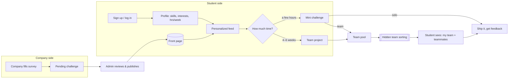

# Rungs

**Real challenges from real companies, sized to a student's week.**
Built for the HackOHI/O 2026 *Bridge Builder* challenge (99P Labs / Honda).

Rungs is a two-sided platform:

- **Companies** fill out a short survey describing a problem. We turn it into a challenge on the front page.
- **Students** sign up, build a quick skills profile, get a personalized feed, and pick a **mini challenge** (a few hours) or a **4–6 week team project**, depending on how much time they have.
- For team challenges, **we form the teams**. Sorting is skill-balanced and cross-major, and students never see how it works. They just meet their team.

It targets rungs 3 and 4 of the challenge's "ladder" (*try something small → join a project*) and makes the step between them easy.

---

## The idea in one picture



More detail (data model, request flow, algorithms) is in [docs/architecture.md](docs/architecture.md).

---

## What's in the MVP

| Flow | Who | Where |
|---|---|---|
| Sign up / log in (email + password, session cookie) | everyone | `#/signup`, `#/login` |
| Profile setup: major, year, skills (learning / comfortable / strong), interests, hours per week, preferred team role | student | `#/profile` |
| Front page with a **"how much time do you have?"** toggle (mini vs. project) | everyone | `#/` |
| **"Picked for you"** feed with a short reason on every card ("Uses your python · Fits your 6 hrs/week") | student | `#/` |
| Join a challenge, or join the team pool | student | `#/c/:id` |
| **Company survey** to post a challenge (size, solo/team, team size, skills, topics, mentor, deliverable) | company | `#/company` |
| Review and publish submissions, then **form teams** when sign-ups close | admin | `#/admin` |
| Internal team view with balance metrics | admin + posting company | `#/teams/:id` |
| "My challenges" with your team once it's assigned | student | `#/my` |

### Matching algorithm (student feed)

`server/matching.js` scores every open challenge for a student from 0 to 1:

| Signal | Weight | Meaning |
|---|---|---|
| Skill fit | 0.40 | Average of the student's level on each required skill |
| Interest fit | 0.25 | Share of challenge topics the student picked |
| Time fit | 0.20 | Student's hrs/week ÷ challenge hrs/week (capped at 1) |
| Stretch | 0.10 | Bonus when they know at least half the skills: there's something to learn, but it isn't a wall |
| Early spot | 0.05 | Boost for challenges that still need people (helps solve the "empty room" problem) |

Each card shows its reasons, so the feed is explainable.

### Team sorting (hidden from students)

`server/teams.js`:

1. Rank pool members by strength on the challenge's required skills.
2. **Snake-draft** them into `round(n / team_size)` teams so strong members are spread out.
3. **Hill-climb** with random member swaps to minimize
   `2.0·(strength imbalance) + 1.0·(missing skill coverage) + 0.4·(same-major teams) + 0.2·(duplicate roles)`.

The run is deterministic, so it gives the same result every time for the same pool. Students only get their team name and teammates' names, majors and roles. The scores stay internal, so nobody can game their profile to land on a particular team.

---

## Run it

Requires **Node 22.5+**. It uses the built-in `node:sqlite`, so there's no database to install.

```bash
npm install
npm start          # http://localhost:3000, seeds demo data on first run
npm test           # algorithm tests
npm run seed       # wipe and reseed the demo database
```

### Demo accounts (password `demo1234`)

| Role | Email |
|---|---|
| Student | `maya@demo.rungs`, `priya@demo.rungs`, `jordan@demo.rungs`, … |
| Company | `lakefront@demo.rungs`, `northline@demo.rungs`, `scioto@demo.rungs` |
| Admin | `admin@demo.rungs` |

**Two-minute demo:** log in as `lakefront@` and submit a challenge → log in as `admin@`, publish it, then click **Form teams** on "Predictive maintenance dashboard" → log in as `maya@` and open that challenge to see your team.

All people, companies and challenges in the seed data are made up.

---

## Stack

- **Backend:** Node + Express 5, SQLite through `node:sqlite`, scrypt password hashing, HTTP-only session cookies
- **Frontend:** a single-page app in vanilla JS with hash routing and no build step
- **Layout:**

```
server/
  index.js      entry: seed + listen
  app.js        all REST routes
  db.js         schema + JSON helpers
  auth.js       hashing, sessions, role guards
  catalog.js    fixed skill / interest / role vocabularies
  matching.js   student feed scoring
  teams.js      hidden team sorting
  seed.js       demo data
public/         index.html, app.js, styles.css
test/           node:test unit tests for the algorithms
docs/           architecture notes
```

## Next steps

- Let companies tune what a team needs ("at least one designer")
- Peer feedback after a challenge ends: a trusted record that AI can't generate (rung 5)
- Use challenge outcomes to improve matching (who finished, who came back)
- OSU SSO in place of email/password
- Mentor office-hour slots: an hour of a mentor's time, not six weeks
