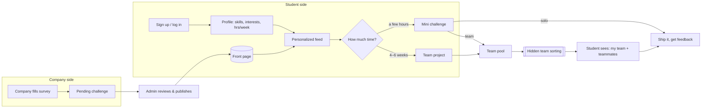

# Rungs

**Real challenges from real companies, sized to a student's week.**
Built for the HackOHI/O 2026 *Bridge Builder* challenge (99P Labs / Honda).

Rungs is a two-sided platform:

- **Companies** fill out a short survey describing a problem. We turn it into a challenge on the front page.
- **Students** sign up, build a quick skills profile, get a personalized feed, and pick a **mini challenge** (a few hours) or a **4–6 week team project**, depending on how much time they have.
- **Every challenge has a schedule**: a sign-up deadline, a start and an end, in the company's time zone. Students sign up days or weeks ahead (say, for a Sunday 5–6pm session). At the deadline, sign-ups lock and teams form automatically.
- For team challenges, **we form the teams**. Sorting is skill-balanced and cross-major, and students never see how it works. They just meet their team.

It targets rungs 3 and 4 of the challenge's "ladder" (*try something small → join a project*) and makes the step between them easy.

---

## The idea in one picture



More detail (data model, request flow, algorithms) is in [docs/architecture.md](docs/architecture.md).

---

## What's in the MVP

| Flow | Who | Where |
|---|---|---|
| Sign up / log in (email + password, session cookie) | everyone | `#/signup`, `#/login` |
| Profile setup: major, year, skills (learning / comfortable / strong), interests, hours per week, preferred team role | student | `#/profile` |
| Front page with a **"how much time do you have?"** toggle (mini vs. project) | everyone | `#/` |
| **"Picked for you"** feed with a short reason on every card ("Uses your python · Fits your 6 hrs/week") | student | `#/` |
| Join a challenge, or join the team pool, before the sign-up deadline. Blocked if it's full or clashes with another mini challenge you joined | student | `#/c/:id` |
| Schedule timeline on each challenge (sign-ups close → starts → ends), shown in the challenge's time zone and the viewer's own | everyone | `#/c/:id` |
| **Company survey** to post a challenge (size, solo/team, team size, skills, topics, mentor, deliverable, **time zone, sign-up deadline, start, end, max participants**) | company | `#/company` |
| Review and publish submissions. Teams form on their own at the deadline; admins can close sign-ups early or re-sort | admin | `#/admin` |
| Internal team view with balance metrics | admin + posting company | `#/teams/:id` |
| "My challenges" with your team once it's assigned | student | `#/my` |

### Challenge lifecycle

All times are stored in UTC, and each challenge keeps its own time zone. The phase is worked out from the dates:

```
pending ──publish──▶ open ──sign-up deadline──▶ locked ──start──▶ live ──end──▶ ended
                       │                          ▲
                       └── students join/leave    └── teams auto-formed here
```

`server/lifecycle.js` runs once a minute and forms teams for any team challenge whose deadline has passed. Mini challenges are treated as live events, so a student can't join two that overlap in time.

### Matching algorithm (student feed)

`server/matching.js` scores every open challenge for a student from 0 to 1:

| Signal | Weight | Meaning |
|---|---|---|
| Skill fit | 0.40 | Average of the student's level on each required skill |
| Interest fit | 0.25 | Share of challenge topics the student picked |
| Time fit | 0.20 | Student's hrs/week ÷ challenge hrs/week (capped at 1) |
| Stretch | 0.10 | Bonus when they know at least half the skills: there's something to learn, but it isn't a wall |
| Early spot | 0.05 | Boost for challenges that still need people (helps solve the "empty room" problem) |

Each card shows its reasons, so the feed is explainable.

### Team sorting (hidden from students)

`server/teams.js`:

1. Rank pool members by strength on the challenge's required skills.
2. **Snake-draft** them into teams so strong members are spread out. Teams aim for the requested size and never grow past size + 1 (7 people for teams of 4 → 4 + 3).
3. **Hill-climb** with random member swaps to minimize
   `2.0·(strength imbalance) + 1.0·(missing skill coverage) + 0.4·(same-major teams) + 0.2·(duplicate roles)`.

The run is deterministic, so it gives the same result every time for the same pool. Students only get their team name and teammates' names, majors and roles. The scores stay internal, so nobody can game their profile to land on a particular team.

---

## Run it

Requires **Node 22.5+**. It uses the built-in `node:sqlite`, so there's no database to install.

```bash
npm install
npm start          # http://localhost:3000, seeds demo data on first run
npm test           # algorithm tests
npm run seed       # wipe and reseed the demo database
```

### Demo accounts (password `demo1234`)

| Role | Email |
|---|---|
| Student | `maya@demo.rungs`, `priya@demo.rungs`, `jordan@demo.rungs`, … |
| Company | `lakefront@demo.rungs`, `northline@demo.rungs`, `scioto@demo.rungs` |
| Admin | `admin@demo.rungs` |

**Two-minute demo:** on first start, the "48-hour UX teardown" deadline has already passed, so its teams form automatically (see the server log). Then: log in as `lakefront@` and submit a challenge with a schedule → log in as `admin@`, publish it, and click **Close sign-ups & form teams** on "Predictive maintenance dashboard" → log in as `maya@` and open that challenge to see your team and its kickoff time.

Seed dates are relative to today, so the demo always has open, locked, live and ended challenges. If you pull an older version with a different schema, the local demo database resets itself.

All people, companies and challenges in the seed data are made up.

---

## Stack

- **Backend:** Node + Express 5, SQLite through `node:sqlite`, scrypt password hashing, HTTP-only session cookies
- **Frontend:** a single-page app in vanilla JS with hash routing and no build step. OSU scarlet (`#BB0000`) and gray (`#666666`), the Figtree font, dark mode first, Spotify-style rows of cards and Apple-style controls
- **Layout:**

```
server/
  index.js      entry: seed + listen
  app.js        all REST routes
  db.js         schema + JSON helpers
  auth.js       hashing, sessions, role guards
  catalog.js    fixed skill / interest / role vocabularies
  matching.js   student feed scoring
  teams.js      hidden team sorting
  lifecycle.js  auto-close sign-ups + auto team formation (runs every minute)
  time.js       time zones, challenge phase, overlap checks
  seed.js       demo data
public/         index.html, app.js, styles.css
test/           node:test unit tests (algorithms + scheduling)
docs/           architecture notes
```

## Next steps

- Let companies tune what a team needs ("at least one designer")
- Peer feedback after a challenge ends: a trusted record that AI can't generate (rung 5)
- Use challenge outcomes to improve matching (who finished, who came back)
- OSU SSO in place of email/password
- Mentor office-hour slots: an hour of a mentor's time, not six weeks
