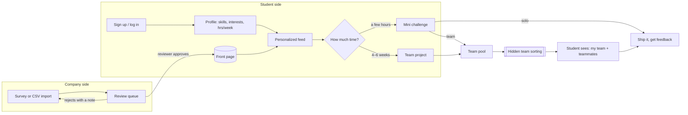

# Rungs

**Real challenges from real companies, sized to a student's week.**
Built for the HackOHI/O 2026 *Bridge Builder* challenge (99P Labs / Honda).

Rungs is a two-sided platform:

- **Companies** fill out a short survey describing a problem, or **import many at once from a CSV**. No account is needed to submit, but **every submission waits for a reviewer** before it goes live. A company account is optional and lets you track your posts and see the teams.
- **Students** sign up, build a quick skills profile, get a personalized feed, and pick a **mini challenge** (a few hours) or a **4–6 week team project**, depending on how much time they have.
- **Then the team ships**: while a challenge is live, each team (or solo student) submits a **GitHub link** plus an optional demo. When it ends, the company scores every submission (impact, execution, presentation, 1–5 each) with feedback, picks up to three **winners**, and announces them. Winners go on the public challenge page, and every student sees their own scores and feedback.
- **Every challenge has a schedule**: a sign-up deadline, a start and an end, in the company's time zone. Students sign up days or weeks ahead (say, for a Sunday 5–6pm session). At the deadline, sign-ups lock and teams form automatically.
- For team challenges, **we form the teams**. Sorting is skill-balanced and cross-major, and students never see how it works. They just meet their team.

It targets rungs 3 and 4 of the challenge's "ladder" (*try something small → join a project*) and makes the step between them easy.

---

## The idea in one picture



More detail (data model, request flow, algorithms) is in [docs/architecture.md](docs/architecture.md).

---

## What's in the MVP

| Flow | Who | Where |
|---|---|---|
| Sign up / log in (email + password, session cookie) | everyone | `#/signup`, `#/login` |
| Profile setup: major, expected graduation year, skills (learning / comfortable / strong), interests, hours per week, preferred team role | student | `#/profile` |
| Front page with a **"how much time do you have?"** toggle (mini vs. project) | everyone | `#/` |
| **"Picked for you"** feed with a short reason on every card ("Uses your python · Fits your 6 hrs/week") | student | `#/` |
| Join a challenge, or join the team pool, before the sign-up deadline. Blocked if it's full or clashes with another mini challenge you joined | student | `#/c/:id` |
| Schedule timeline on each challenge (sign-ups close → starts → ends), shown in the challenge's time zone and the viewer's own | everyone | `#/c/:id` |
| **Company survey** to post a challenge (company name, size, solo/team, team size, skills, topics, mentor, deliverable, **time zone, sign-up deadline, start, end, max participants**) | anyone | `#/post` |
| **CSV import**: download the template, upload or paste, see every row checked (dry run), send the valid ones for review | anyone | `#/post` → Import CSV |
| **Review queue**: checklist, approve & publish, or reject with a required note (shown to the company) | reviewer | `#/review` |
| **Submit work**: GitHub repo (required) + demo/slides link + summary, one per team, editable until the end | student | `#/c/:id` while live |
| **Judging**: score 1–5 in three categories + feedback, suggest top 3, announce winners | posting company, reviewer | `#/judge/:id` |
| **Results**: public winners with links; private scores and feedback for each team | everyone / student | `#/c/:id` |
| **Demo controls** (dev only): add sample sign-ups/submissions/grades and fast-forward a challenge stage by stage | anyone, `npm run dev` | `#/c/:id` |
| **Team simulator**: invent a pool of students for any team challenge, run the real sorting, compare against random teams | company, reviewer | `#/simulate` |
| "Your challenges" dashboard. Teams form on their own at the deadline; the posting company can close sign-ups early or re-sort | company account | `#/company` |
| Internal team view with balance metrics | posting company | `#/teams/:id` |
| "My challenges" with your team once it's assigned | student | `#/my` |

### Challenge lifecycle

All times are stored in UTC, and each challenge keeps its own time zone. The phase is worked out from the dates:

```
submitted ──review──▶ open ──sign-up deadline──▶ locked ──start──▶ live ──end──▶ ended ──winners──▶ results
                                    (sign up)                        (teams set)     (submit links)  (judging)
                       │                          ▲
                       └── students join/leave    └── teams auto-formed here
```

`server/lifecycle.js` runs once a minute and forms teams for any team challenge whose deadline has passed. Mini challenges are treated as live events, so a student can't join two that overlap in time.

### Matching algorithm (student feed)

`server/matching.js` scores every open challenge for a student from 0 to 1:

| Signal | Weight | Meaning |
|---|---|---|
| Skill fit | 0.40 | Average of the student's level on each required skill |
| Interest fit | 0.25 | Share of challenge topics the student picked |
| Time fit | 0.20 | Student's hrs/week ÷ challenge hrs/week (capped at 1) |
| Stretch | 0.10 | Bonus when they know at least half the skills: there's something to learn, but it isn't a wall |
| Early spot | 0.05 | Boost for challenges that still need people (helps solve the "empty room" problem) |

Each card shows its reasons, so the feed is explainable.

### Team sorting (hidden from students)

`server/teams.js`:

1. Rank pool members by strength on the challenge's required skills.
2. **Snake-draft** them into teams so strong members are spread out. Teams aim for the requested size and never grow past size + 1 (7 people for teams of 4 → 4 + 3).
3. **Hill-climb** with random member swaps to minimize
   `2.0·(strength imbalance) + 1.0·(missing skill coverage) + 0.4·(same-major teams) + 0.2·(duplicate roles)`.

The run is deterministic, so it gives the same result every time for the same pool. Students only get their team name and teammates' names, majors and roles. The scores stay internal, so nobody can game their profile to land on a particular team.

---

## Run it

Requires **Node 22.5+**. It uses the built-in `node:sqlite`, so there's no database to install.

```bash
npm install
npm run dev        # React (Vite) on http://localhost:5173 + API on :3000, both reload on save
npm start          # production: builds the React app into dist/ and serves it all on http://localhost:3000
npm test           # algorithm tests
npm run seed       # wipe and reseed the demo database
```

### End-to-end demo video

`media/rungs-end-to-end.mp4` (not in git; regenerate any time) walks one mini team challenge through every step: post → review → sign-ups → teams → GitHub submission → judging → winners → feedback, with captions.

```bash
npm run demo:video
```

This uses your installed Google Chrome (through `playwright-core`) against a throwaway database, and encodes the MP4 with macOS's built-in AVFoundation (`scripts/frames-to-mp4.swift`). It needs macOS, Chrome and the Xcode command line tools; nothing else is downloaded.

### Demo accounts (password `demo1234`)

| Role | Email |
|---|---|
| Student | `maya@demo.rungs`, `priya@demo.rungs`, `jordan@demo.rungs`, … |
| Company | `lakefront@demo.rungs`, `northline@demo.rungs`, `scioto@demo.rungs` |
| Reviewer | `reviewer@demo.rungs` |

**Two-minute demo:** on first start, the "48-hour UX teardown" deadline has already passed, so its teams form automatically (see the server log). Then:
1. Open **Post a challenge** (no login needed) and submit one, or switch to **Import CSV** and paste the template.
2. Log in as `reviewer@`: the queue already has two seeded submissions. Approve one and reject one with a note.
3. Log in as `lakefront@`, open **Team simulator**, and run it on "Predictive maintenance dashboard" to see Rungs sorting beat random teams. Then click **Close sign-ups & form teams** on that challenge for real.
4. Log in as `maya@` and open the challenge to see your team and its kickoff time.

Seed dates are relative to today, so the demo always has open, locked, live and ended challenges. If you pull an older version with a different schema, the local demo database resets itself.

All people, companies and challenges in the seed data are made up.

---

## Stack

- **Backend:** Node + Express 5, SQLite through `node:sqlite`, scrypt password hashing, HTTP-only session cookies
- **Frontend:** React 19 + React Router (hash routes), built with Vite. OSU scarlet (`#BB0000`) and gray (`#666666`), the Figtree font, dark mode first, Spotify-style rows of cards and Apple-style controls
- **Layout:**

```
server/
  index.js      entry: seed + listen
  app.js        all REST routes
  db.js         schema + JSON helpers
  auth.js       hashing, sessions, role guards
  catalog.js    fixed skill / interest / role vocabularies
  matching.js   student feed scoring
  teams.js      hidden team sorting
  lifecycle.js  auto-close sign-ups + auto team formation (runs every minute)
  time.js       time zones, challenge phase, overlap checks
  challenges.js shared validation for survey posts and CSV import rows
  simulate.js   team simulator: generated pools, Rungs sorting vs random
  submissions.js  GitHub-link submissions, grading, winners
  demo.js       dev-only fast-forward controls (RUNGS_DEMO=1)
scripts/
  record-demo.mjs     records the end-to-end demo video
  frames-to-mp4.swift stitches screen frames into an MP4 (AVFoundation)
  seed.js       demo data
client/
  index.html
  src/
    main.jsx, App.jsx        entry + routes
    lib/                     api client, session context + useLoad hook, time formatting
    components/              Nav, ChallengeCard, Shelf, Timeline, StatusChip, ...
    pages/                   Home, Auth, Profile, ChallengeDetail, MyChallenges,
                             PostChallenge, CompanyDashboard, Teams
    styles.css
vite.config.js  dev proxy /api -> :3000, builds to dist/
test/           node:test tests (algorithms, scheduling, import + review + simulator over HTTP)
docs/           architecture notes
```

## Next steps

- Let companies tune what a team needs ("at least one designer")
- Peer feedback after a challenge ends: a trusted record that AI can't generate (rung 5)
- Use challenge outcomes to improve matching (who finished, who came back)
- OSU SSO in place of email/password
- Verify company identity (email domain check) so trusted companies can skip review
- Notify companies by email when a post is approved or rejected
- Mentor office-hour slots: an hour of a mentor's time, not six weeks
