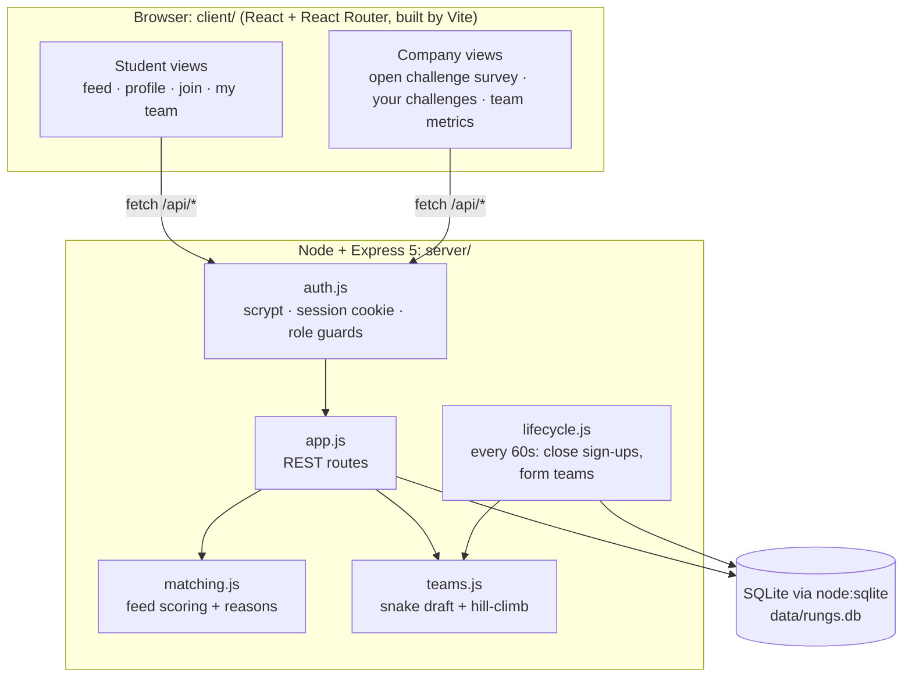
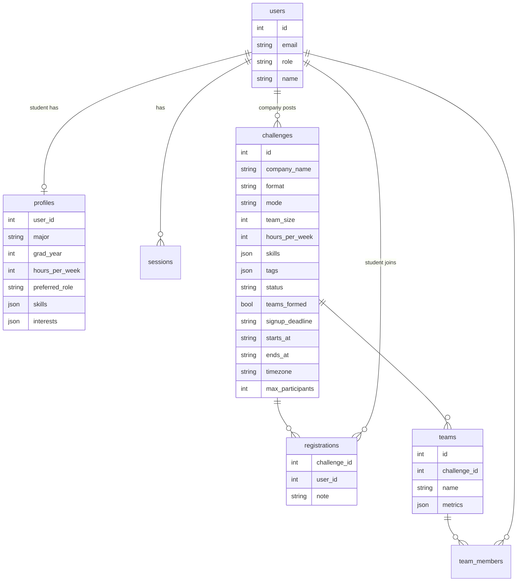
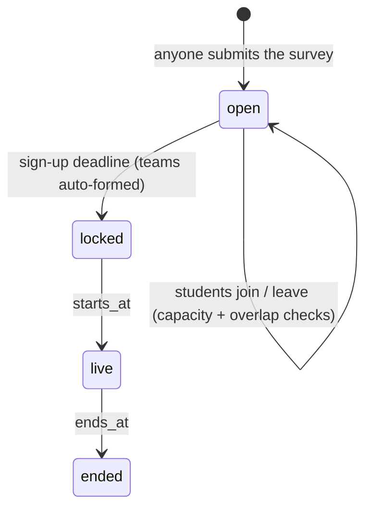

# Architecture

## System

## Data model

`teams.metrics` is internal only. No student-facing route returns it.

## Challenge lifecycle

Posts go live right away (`status = 'published'`). `pending` is kept in the schema for a future review step. The phase is worked out from the dates (`server/time.js`).

The posting company, if it has an account, can close sign-ups early, which moves the deadline to now and forms teams. It can also re-sort while the challenge is `locked`.

## Who can see what

| Data | Student | Company (owner) | Anyone |
|---|---|---|---|
| Published challenges | ✓ | ✓ | ✓ |
| Post a challenge | ✓ | ✓ (owns it) | ✓ (no owner) |
| Personal feed + reasons | own | | |
| Own team (names, majors, grad year, roles) | ✓ | | |
| All teams + metrics + skill levels | | ✓ | |

## API

| Method | Path | Role |
|---|---|---|
| POST | `/api/auth/signup` · `/login` · `/logout` | public |
| GET | `/api/me` · `/api/meta` | public |
| PUT | `/api/profile` | student |
| GET | `/api/challenges?format=mini\|project` | public |
| GET | `/api/challenges/recommended` | student |
| GET | `/api/challenges/:id` | public (adds `joined`, `myTeam` for students) |
| POST/DELETE | `/api/challenges/:id/join` | student |
| GET | `/api/my/challenges` | student |
| POST | `/api/challenges` | anyone (open pipeline) |
| GET | `/api/company/challenges` | company |
| POST | `/api/company/challenges/:id/form-teams` | owning company |
| GET | `/api/challenges/:id/teams` | owning company |
