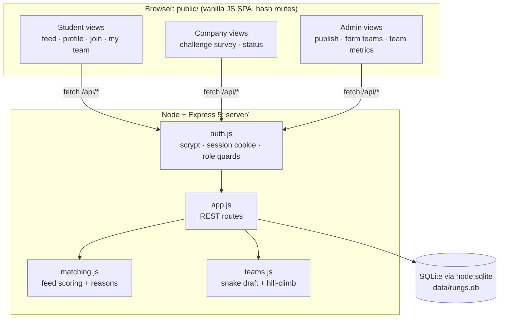
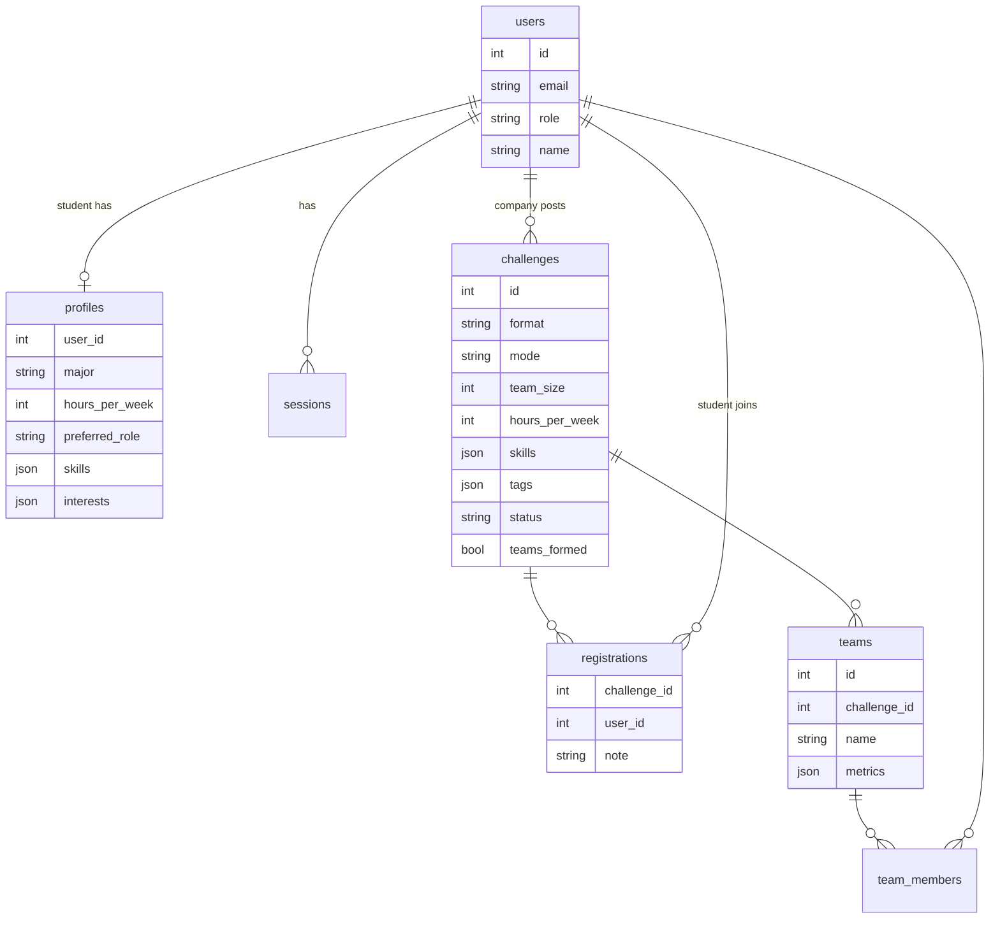
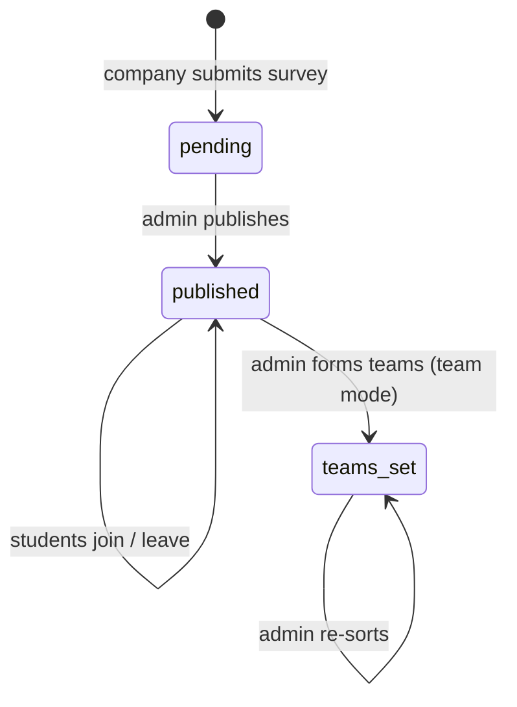

# Architecture

## System

## Data model

`teams.metrics` is internal only. No student-facing route returns it.

## Challenge lifecycle

## Who can see what

| Data | Student | Company (owner) | Admin |
|---|---|---|---|
| Published challenges | ✓ | ✓ | ✓ |
| Personal feed + reasons | own | | |
| Own team (names, majors, roles) | ✓ | | |
| All teams + metrics + skill levels | | ✓ | ✓ |
| Pending challenges | | own | ✓ |

## API

| Method | Path | Role |
|---|---|---|
| POST | `/api/auth/signup` · `/login` · `/logout` | public |
| GET | `/api/me` · `/api/meta` | public |
| PUT | `/api/profile` | student |
| GET | `/api/challenges?format=mini\|project` | public |
| GET | `/api/challenges/recommended` | student |
| GET | `/api/challenges/:id` | public (adds `joined`, `myTeam` for students) |
| POST/DELETE | `/api/challenges/:id/join` | student |
| GET | `/api/my/challenges` | student |
| POST/GET | `/api/company/challenges` | company |
| GET | `/api/admin/challenges` | admin |
| POST | `/api/admin/challenges/:id/publish` | admin |
| POST | `/api/admin/challenges/:id/form-teams` | admin |
| GET | `/api/challenges/:id/teams` | admin, owning company |
